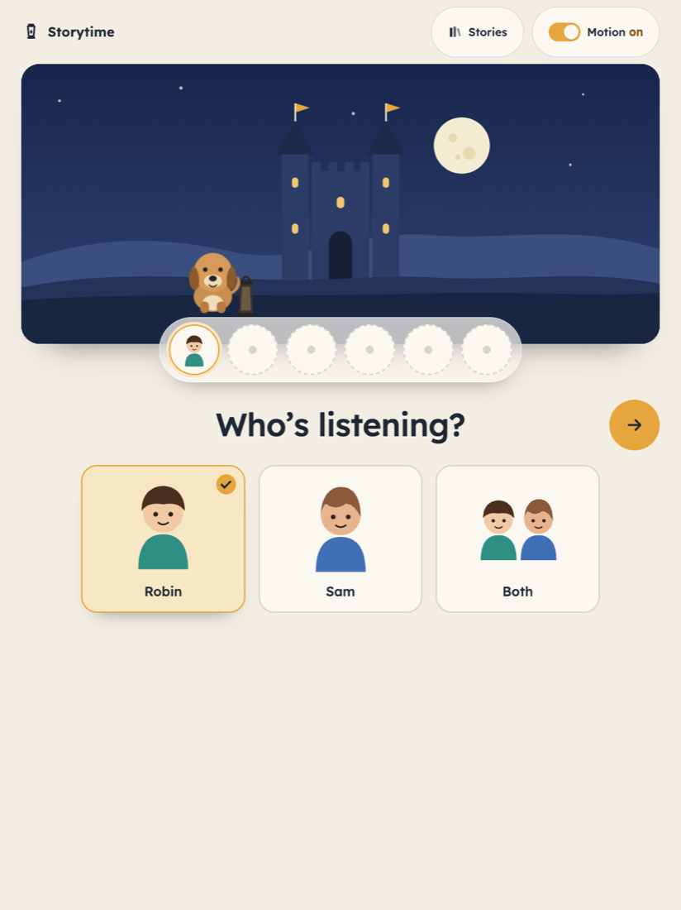
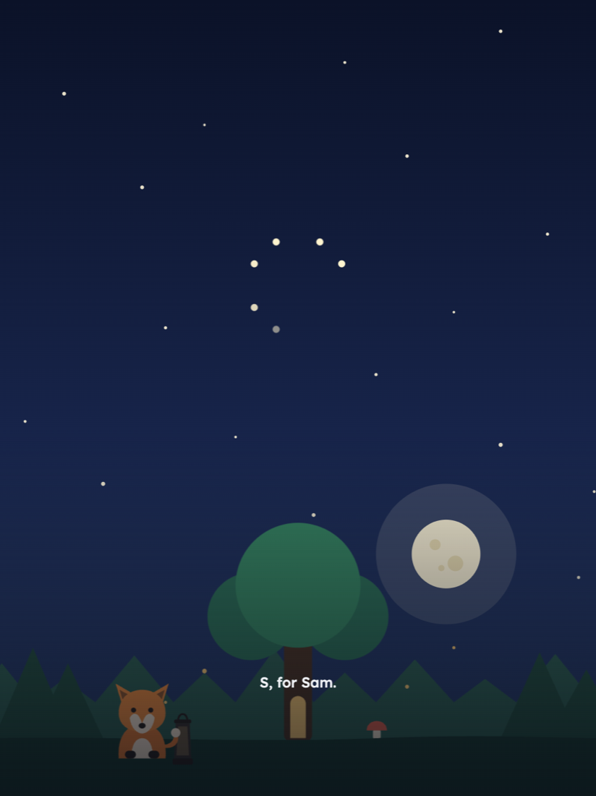
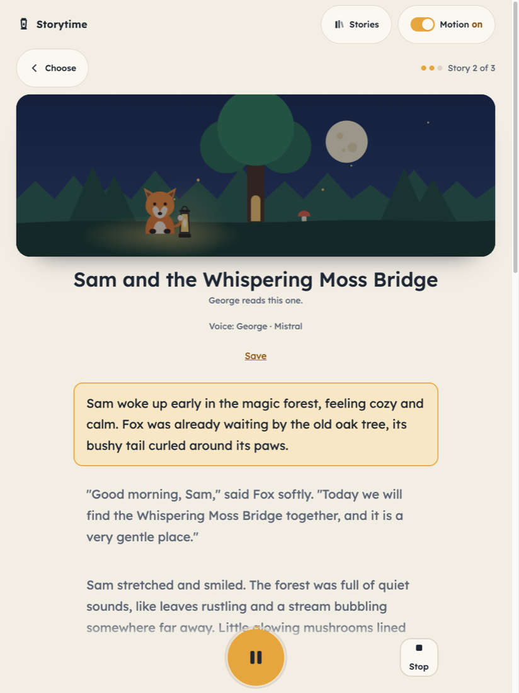
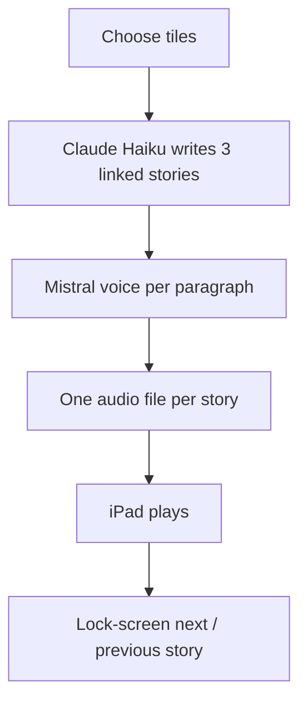

# Storytime

Storytime is a small bedtime story app for a household. Choose a listener, world, friend, mood, length, and reader. It writes three linked stories, makes spoken audio, and saves the text and WAV files on the computer running the server.


| Choose | Making the story | Playing | Sleep |
|---|---|---|---|
|  |  |  |  |

## Design

A paper-cut night scene is made with inline SVG and CSS, with no image files for the scene. A Motion switch keeps the scene still when you prefer, and the app follows reduced-motion settings.

## Security: home use only

**There is no login, no HTTPS, and no rate limit. Anyone who can reach the app on your network can spend your API credit and read saved stories. Never expose it to the internet or port-forward it.**

Use a private network or a VPN such as Tailscale. The example binds only to `127.0.0.1`, so other devices cannot reach it until you change the host. A VPN does not add a login to this app. Only allow people you trust to reach the server.

The child's first name, age, optional hero name, and story choices are sent to Anthropic. The story text, including names that appear in it, is sent to Mistral for speech. Optional local flavour is also sent to Anthropic. Use made-up names if you prefer. Saved stories contain those choices and generated text.

## How it works



The first paragraph can play while the rest is being made. Completed stories use one WAV file with short pauses between paragraphs. The player shows text, the reader, and the engine used for the current paragraph.

Media Session connects play, pause, and next/previous story to browser and lock-screen controls where supported. Browser and iPad support varies. Playback starts with a tap. The screen dims after 20 seconds of playback.

## What it uses

- FastAPI and Uvicorn, with Pydantic for input validation.
- Claude Haiku 5.5 (`claude-haiku-5-5`) through the Anthropic API.
- Mistral Voxtral TTS (`voxtral-mini-tts-2603`) for the main voice engine.
- Optional Kokoro fallback, supplied separately.
- Plain HTML and JavaScript, with Media Session. There is no frontend build.
- Python's standard library for provider requests, WAV assembly, storage, and offline tests. The page loads the Lexend font from Google Fonts and can use system fonts if it is unavailable.

## Setup in 5 commands

Use Python 3.11 or newer. Download the project into a folder named `storytime-public`, then run:

```sh
cd storytime-public
python3 -m venv .venv
.venv/bin/pip install -r requirements.txt
cp config.example.json config.json
cp .env.example .env
```

Edit `.env` to add your own `ANTHROPIC_API_KEY` and `MISTRAL_API_KEY`. Alternatively, export them in your shell. Exported variables take precedence over `.env`. The parser accepts one `NAME=value` per line, optional `export`, quoted values, and comments. It does not expand shell commands or variable references. Only the two provider key names are loaded, from this project folder.

Edit `config.json` with the listeners' first names and ages. The example uses Robin, 8, and Sam, 5. Names must be unique and cannot be `Both` or `Everyone`. Ages are whole numbers from 1 to 18. A group choice uses the youngest listener's age. `local_flavour` is optional setting text and defaults to empty.

`mistral_voices` maps the two reader choices, `bf_emma` and `bm_george`, to Mistral voice IDs. The tiles label them Emma and George. Those labels identify reader slots, rather than Mistral's preset names. You can replace the IDs. `host` and `port` control the listener address. Restart the server after changing configuration. Without `config.json`, the app uses `config.example.json`.

Run the server:

```sh
.venv/bin/python server.py
```

Open `http://127.0.0.1:8787` on that computer. Keep the terminal running, and use Ctrl+C to stop it. Run the offline checks with `.venv/bin/python test_storytime.py`.

## Using an iPad on the home network

Set `"host": "0.0.0.0"` in `config.json` and restart the server. This listens on all interfaces. Keep the iPad and server on your private home network. Allow the configured port through the computer's firewall only for your trusted network.

In iPad Safari, open `http://YOUR-COMPUTER-LAN-IP:8787`, using the server computer's local address and your configured port. Tap Make my story, then Play. You can also add the page to the Home Screen. Next/previous story uses Media Session where Safari exposes those controls. Previous returns to a story visited in the current session, or restarts the current story.

## Optional local voice fallback

The author's fallback is Kokoro through a small local script, using the `kokoro-onnx` voices `bf_emma` and `bm_george`. That script and its model files are not included. Supply your own local script and install its dependencies separately if you want this fallback.

Set `fallback_tts_command` to a command template, for example:

```json
"fallback_tts_command": "python3 local_tts.py --voice {voice} --output {output}"
```

The server substitutes the selected reader into `{voice}` and a temporary WAV path into `{output}`. It passes the paragraph as UTF-8 text on standard input. The script must write a nonempty mono, 16-bit PCM WAV at 24 kHz, and return a nonzero exit code on failure. Arguments are parsed with shell-style quoting, but no shell is executed. Pipes and shell expansions are not supported. Quote paths containing spaces.

Mistral remains the main engine. Leave the command empty to disable fallback. If Mistral fails without a fallback, the story text is saved and the page shows an audio error. Failed audio is not retried on every poll; make another story after fixing the provider or fallback.

## Storage and cost

Stories are saved under `stories/`. Downloads are WAV files and can be large. Saved text and audio remain until you remove them. Configuration, keys, generated stories, logs, and the virtual environment are ignored by Git. Keep your own backup if you want to retain stories.

Each story takes a few API calls: one text request and speech requests for its paragraphs. Choosing a story also starts a sequence of up to three stories. You pay your own providers for their API usage. Longer stories generally use more text and speech. There are no built-in spending limits.

AI-generated stories can contain mistakes or unsuitable content despite the gentle-story prompt. A parent should review what is appropriate for their child.

## License and author

See [LICENSE](LICENSE) for PolyForm Noncommercial 1.0.0 and its required notice.

Built with AI coding agents, directed by Emanuel Covasa.
